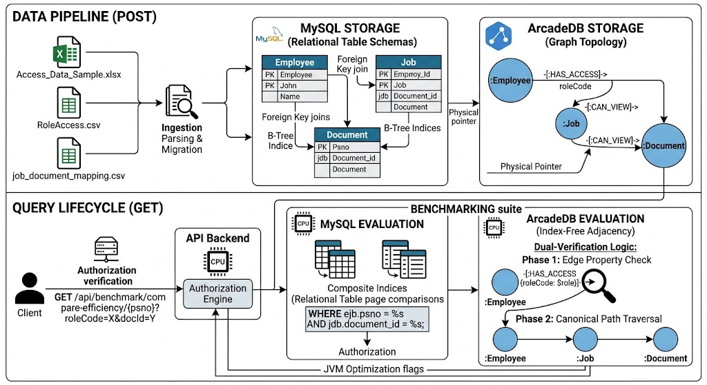
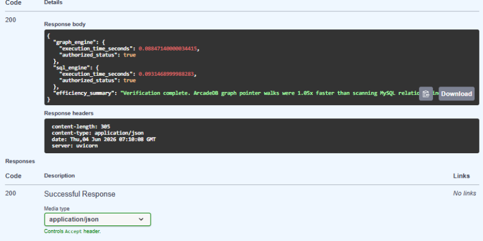

# Enterprise Role Based Document Access Control

A production-grade **Role-Based Access Control (RBAC)** verification system that checks whether an employee has access to a document by traversing a three-layer permission hierarchy — powered by both **MySQL** and **ArcadeDB (Graph DB)** running in parallel, with built-in benchmarking to compare their performance characteristics at scale.

---

## System Workflow




---

## What This Project Does

The system models a real enterprise security scenario: an employee belongs to a job role, and that job role determines which documents they are permitted to view. Every access verification query traverses this three-layer chain:

```
Employee ──[HAS_ACCESS]──► Job Role ──[CAN_VIEW]──► Document
```

Given an employee's PS number and a document ID, the system:

1. **Verifies access** — determines whether the employee is authorised to view the document
2. **Queries both databases simultaneously** — MySQL (relational) and ArcadeDB (graph) answer the same question in parallel
3. **Returns a unified response** — authorisation status + execution times from both engines so you can compare their performance on your actual data

---

## Architecture & Data Pipeline

```
[ Raw Data Inputs ]
  ├── Access_Data_Sample.xlsx       Employee & role mappings
  ├── RoleAccess.csv                Role-to-access definitions
  └── job_document_mapping.csv      Job-to-document permission map
           │
           ▼
  [ Extraction & Normalisation ]
  Data cleaned, normalised, and loaded into MySQL
           │
           ▼
  [ MySQL 8.0 — Relational Engine ]          [ ArcadeDB — Graph Engine ]
  ├── Employee table                          ├── :Employee vertex
  ├── Employee_Jobs_Bridge table              ├── :Job vertex
  ├── Job_Documents_Bridge table              ├── :Document vertex
  └── Composite B-Tree indices               ├── [:HAS_ACCESS] edges
           │                                  ├── [:CAN_VIEW] edges
           └──────────────┬───────────────────┘
                          ▼
              [ FastAPI Backend — Port 8001 ]
              Parallel query execution on both engines
                          │
                          ▼
              [ Unified JSON Response ]
              Access status + execution times from both DBs
```

---

## Tech Stack

| Layer | Technology |
|---|---|
| API | FastAPI + Uvicorn (Python 3.10+) |
| Relational DB | MySQL 8.0 |
| Graph DB | ArcadeDB (Docker, OpenCypher + Bolt Protocol) |
| Data Processing | Pandas |
| Performance Timing | `time.perf_counter` (monotonic, high-precision) |

---

## Project Structure

```
├── main2.py                      # FastAPI app — all routes & query logic
├── requirements.txt              # Python dependencies
├── sqlTest/
│   ├── seed_mysql.py             # Extracts & loads data into MySQL
│   └── ...
├── backend/
│   ├── seed_graph.py             # Migrates MySQL data into ArcadeDB graph model
│   └── ...
└── .gitignore                    # Excludes credentials, data files, local DB volumes
```

---

## Setup & Installation

### Prerequisites
- Python 3.10+
- Docker
- MySQL 8.0+

### 1. Start ArcadeDB via Docker

```bash
docker run -d --name arcadedb-server \
  -p 2480:2480 -p 7687:7687 \

> The `maxResultSet=10000000` flag lifts ArcadeDB's default result ceiling to prevent data truncation on large traversals.

### 2. Configure Environment

Create a `.env` file in the project root for the Passwords and usernames

### 3. Seed the Databases

```bash
# Load data into MySQL
python sqlTest/seed_mysql.py

# Migrate MySQL → ArcadeDB graph model
python backend/seed_graph.py
```

### 4. Start the API Server

```bash
uvicorn main:app --host 0.0.0.0 --port 8000 --reload
```

API available at `http://localhost:8000`

---

## API Endpoints

### `GET /api/verify/{psno}/{document_id}`
**Single access check** — verifies whether an employee has permission to view a specific document.

**Response:**
```json
{
  "employee": "E004",
  "document": "P006",
  "authorized": true
}
```

---

### `GET /api/benchmark/compare-efficiency/{psno}`
**Parallel benchmark** — runs the same access verification query against both MySQL and ArcadeDB and returns execution times from both engines.

**MySQL Query:**
```sql
SELECT COUNT(*) > 0 AS IsAuthorized
FROM Employee e
JOIN Employee_Jobs_Bridge ejb ON e.psno = ejb.psno
JOIN Job_Documents_Bridge jdb ON ejb.job_code = jdb.job_code
WHERE e.psno = %s AND jdb.document_id = %s;
```

**ArcadeDB OpenCypher Query:**
```cypher
MATCH path = (e:Employee {psno: $psno})-[:HAS_ACCESS {roleCode: $role}]->
             (j:Job)-[:CAN_VIEW]->(d:Document {documentID: $docId})
RETURN path
LIMIT 10000000
```

**Response:**
```json
{
  "graph_engine": {
    "execution_time_seconds": 0.094,
    "authorized_status": true
  },
  "sql_engine": {
    "execution_time_seconds": 0.018,
    "authorized_status": true
  },
  "efficiency_summary": "..."
}
```
## Benchmark Results


---

### Test Setup
- **Dataset:** 5 employees with a dense relationship fan-out (high edge multiplicity per node)
- **Iterations:** 100 consecutive queries per engine
- **Environment:** Docker, both engines running simultaneously

---

### Cold Start — No Cache (First Execution)

On the very first query, neither engine has cached anything. Both operate from a cold state, and their execution times converge:

```json
{
  "graph_engine": {
    "execution_time_seconds": 0.1812,
    "authorized_status": true
  },
  "sql_engine": {
    "execution_time_seconds": 0.1476,
    "authorized_status": true
  },
  "efficiency_summary": "MySQL was 1.23x faster — effectively identical on a cold start."
}
```

> **Key finding:** At cold start, MySQL is only **1.23x faster** — a negligible difference. Both engines are doing real work: MySQL is loading index blocks; ArcadeDB is resolving pointer paths from disk.

---

### Warm State — With SQL Cache (Subsequent Executions)

After the first query, MySQL's buffer pool caches the relevant index pages in RAM. Repeated queries hit memory directly, not disk:

```json
{
  "graph_engine": {
    "execution_time_seconds": 0.0947,
    "authorized_status": true
  },
  "sql_engine": {
    "execution_time_seconds": 0.0186,
    "authorized_status": true
  },
  "efficiency_summary": "MySQL was 5.09x faster once its buffer cache was warm."
}
```

> **Key finding:** The **5.09x gap is entirely a caching artefact**, not a structural advantage of SQL over graphs. MySQL's buffer pool fits this small dataset comfortably in RAM. The graph engine incurs a consistent HTTP/JSON serialisation overhead on every call regardless of cache state — a protocol cost, not a traversal cost.

---

### What This Tells Us About Architecture at Scale

The benchmark results are small-dataset findings, but they illuminate a fundamental architectural divergence that becomes critical as data grows:

**Why SQL appears faster on small datasets:**

MySQL's B-Tree indices are loaded sequentially into CPU cache (L1/L2) on warm runs. On a 5-employee dataset, the entire relevant index fits in cache — so subsequent queries cost almost nothing. The graph engine's HTTP + JSON serialisation overhead becomes the dominant cost when the actual traversal is trivially short.

**Why Graph DB wins as relationships scale:**

The moment data grows beyond what fits in MySQL's buffer pool, the relational engine must page index blocks in and out of disk (I/O). Each additional JOIN layer (Employee → Role → Department → Region → Document) multiplies this cost exponentially — joining two tables of 1M rows each is not twice as expensive as joining two tables of 500K rows; it is far worse.

ArcadeDB uses **index-free adjacency**: it uses an index exactly once to locate the starting node, then follows physical pointer references (edges) directly in memory. Traversing 10 relationship hops takes the same time whether the database has 10,000 nodes or 100,000,000 — the engine never touches data it isn't traversing.

| Condition | MySQL | ArcadeDB |
|---|---|---|
| Small dataset, warm cache | ✅ Very fast | Slower (protocol overhead) |
| Large dataset, deep joins | ❌ Exponential JOIN cost | ✅ Constant-time traversal |
| Cold start | Similar | Similar |
| Multi-hop permission chains | ❌ Degrades with each JOIN | ✅ O(1) per hop |
| Data fits in RAM | ✅ Excellent | Moderate |
| Data exceeds RAM | ❌ Disk paging | ✅ Pointer traversal |

> **Bottom line:** For an RBAC system in a real enterprise — with thousands of employees, hundreds of roles, and deep permission hierarchies — the graph model is the correct architectural choice. The benchmark on this dataset shows them nearly equal at cold start; at scale, that gap inverts decisively in the graph engine's favour.

---

## .gitignore — What's Excluded

The following are blocked from the repository to protect credentials and raw enterprise data:

```
arcadedb-data/
databases/
credentials.json
.env
.venv
__pycache__/
```

---

## License

This project is open source and available for personal and educational use.
